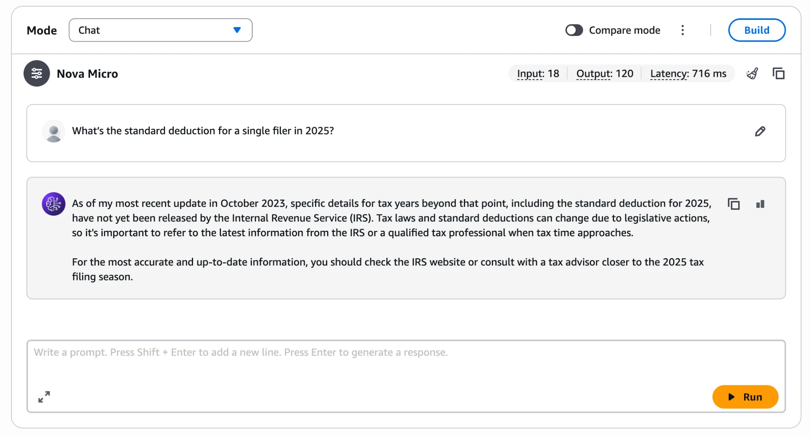
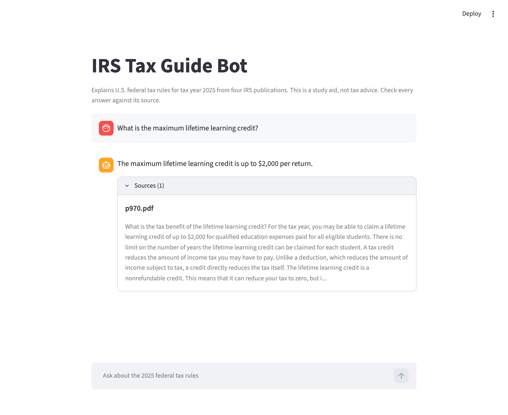
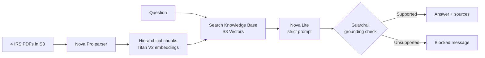
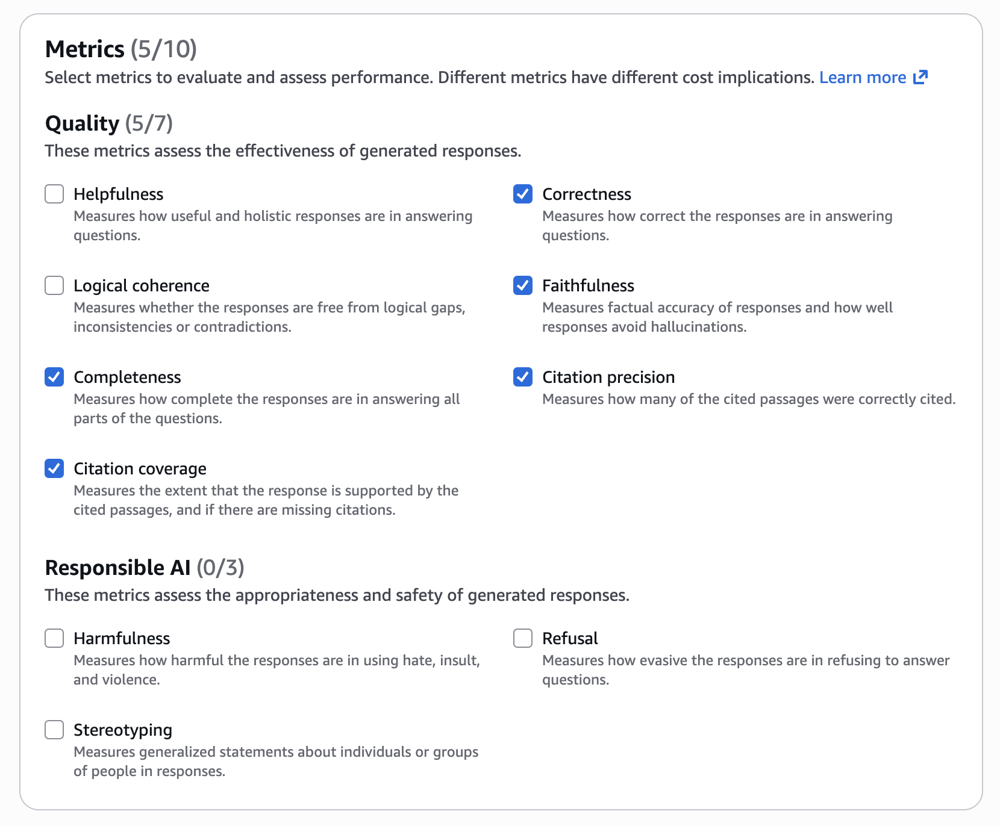
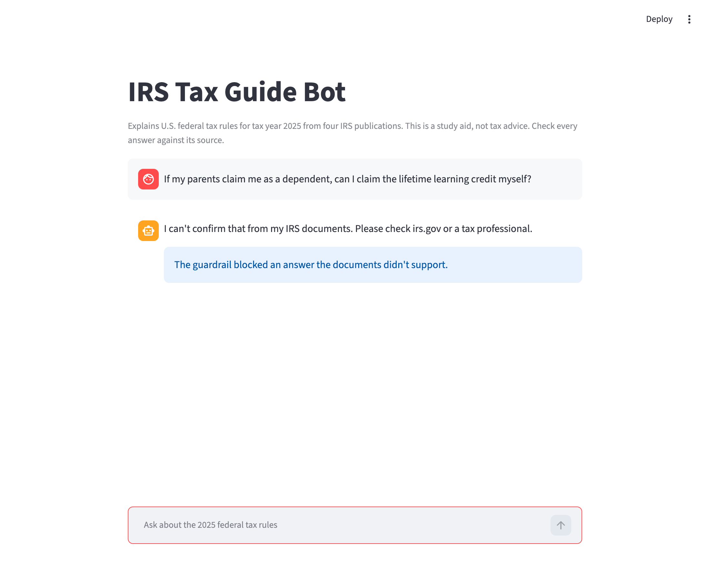

# IRS Tax Guide Bot

A RAG chatbot on Amazon Bedrock that explains U.S. federal tax rules for tax year 2025 using four official IRS publications, with sources for its answers and a guardrail against unsupported ones.

I don't have a deep understanding of my own taxes, and the rules change every year, so I built something I'd actually use. I measured it with evaluations at each stage, because a confident wrong tax answer can cost someone money.

> **Study aid only, not tax advice.** Check answers against the IRS source.

| Without RAG: Nova Micro alone | With this bot |
|---|---|
|  |  |

## How it works



| Part | Choice | Why | Tradeoff |
|---|---|---|---|
| Documents | IRS Pubs 17, 501, 970 and Form 1040 instructions (380 pages) | Official, free, updated yearly | Federal only |
| Parser | Foundation model (Nova Pro) | The default parser left some tables hard to find | One-time cost per page |
| Chunking | Hierarchical (1,500 / 300 tokens, 60 overlap) | Keeps rules near their exceptions | The model reads more text per question |
| Embeddings | Titan Text V2, 1,024 dimensions | Inexpensive and standard | None significant at this size |
| Vector store | S3 Vectors | Far cheaper than OpenSearch Serverless | Semantic search only, no keyword matching |
| Answer model | Nova Lite | Fixed the errors Nova Micro made at a very low cost | Weaker than larger models when passages are thin |
| Safety | Guardrails grounding check (grounding 0.7, relevance 0.5) | Blocks answers the passages don't support | Sometimes blocks answers that might be fine |

## Results

I evaluated each stage on 27 test questions with Bedrock's knowledge base evaluations: simple lookups, rules with conditions, exact form names, and questions the bot should refuse.

| Metric (0 to 1) | Run 1: Baseline | Run 2: Fixes | Run 3: Final with guardrail |
|---|---|---|---|
| Correctness | Unreliable* | 0.94 | 0.91 |
| Faithfulness | 0.80 | 0.91 | 0.84 |
| Completeness | 0.85 | 0.84 | 0.78 |
| Citation precision | 0.86 | 0.94 | 1.00** |
| Citation coverage | 0.85 | 0.85 | 0.77** |

- **Run 1:** default parser, Nova Micro, default prompt, graded by Nova 2 Lite.
- **Run 2:** Nova Pro parser, Nova Lite, strict prompt, graded by Nova Pro.
- **Run 3:** Run 2 plus the guardrail, graded by Nova Pro.

\* The grader scored only 10 of 27 questions on correctness, so I don't report that number. Because the grader changed after Run 1, Runs 2 and 3 are the fair comparison.

\*\* Scored on the 23 questions the bot answered.

**Why the final scores look lower than Run 2:** refusing is sometimes the goal, but the scoring treats it harshly. The final run scored 0 for the two blocked questions, and faithfulness scored 0 for the two correct refusals. On the 23 questions the bot answered, correctness was **0.98** and faithfulness **0.99**. I chose the guardrail because a blocked answer is safer than the wrong answer it replaced, even though it lowers the averages.



## What I tried and what happened

**The baseline scores hid serious errors.** Reading individual answers mattered more than the averages. Nova Micro said the married filing jointly deduction was $25,900 when the correct figure, $31,500, was in its passages, and it invented Texas income tax rates. Texas has no state income tax.

**A strict prompt exposed a search problem.** Once the bot could only use its documents, it refused questions it had seemed to answer. Those earlier answers had likely come from the model's memory, not my documents.

**The default parser wasn't enough for tables.** The lifetime learning credit table never appeared in search results, even with 20 results requested. After re-parsing with a foundation model, it appeared in the top 5.

**A guardrail caught what the prompt missed.** With the strict prompt alone, the bot wrongly said you can claim the lifetime learning credit while being claimed as a dependent. The guardrail blocked that answer.



**A better-looking prompt made things worse.** A friendlier prompt that asked for fuller answers let that same harmful answer through the guardrail, so I rejected it and kept the strict one.

**Query reformulation didn't help.** It didn't fix the failed questions and adds a step to every request, so I left it out. Requesting 10 passages instead of 5 was also worse: the bot used the overtime deduction's $12,500 limit as the student loan limit.

**Fixing an IAM failure.** Evaluation jobs failed with an access denied error. The role's trust policy allowed `model-evaluation-job`, while this job type uses `evaluation-job`, and its permissions didn't cover the evaluation bucket or knowledge base. I corrected the trust policy and scoped access to one bucket, one knowledge base and one guardrail.

## Known limitations

- **Student loan limit:** the bot gives the correct income limits but omits the $2,500 maximum, because search doesn't reliably find it.
- **Overblocking:** the lifetime learning question and a self-employment question are blocked instead of answered. Blocked is safer, but it isn't a real answer.
- **Test set:** the 27 questions were also used for tuning, so scores on new questions would likely be lower.
- **Terse answers:** the strict prompt leaves out some conditions, which is why completeness fell.
- **Scope:** federal rules for tax year 2025 only, from four publications.

## Run it yourself

You need an AWS account, a Bedrock knowledge base, and a guardrail.

```bash
python -m venv .venv
source .venv/bin/activate
pip install -r requirements.txt
cp .env.example .env
```

Add your IDs to `.env`, sign in with `aws login`, then start the app:

```bash
streamlit run app.py
```

## Cost

I estimate about $5 to $10 in AWS usage, covered by free plan credits. Most of it was one-time parsing and evaluation runs. Asking a question costs a fraction of a cent to about a cent.

## Future improvements

1. A larger test set, with questions held back from tuning.
2. Better search: hybrid keyword and semantic search, or chunks split by IRS section.
3. A hand-verified table of key limits, so exact numbers don't depend on search.
4. Tax-year labels, so 2026 documents can be added without mixing years.
5. A stronger answer model and more publications, including self-employment guides.
6. User feedback and logging in the app.

---

Built with [Claude Code](https://claude.com/claude-code) as a development assistant. I made the design decisions and validated results through evaluation.
