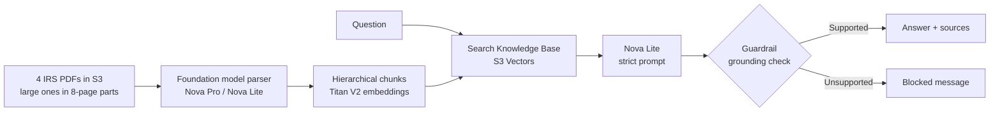
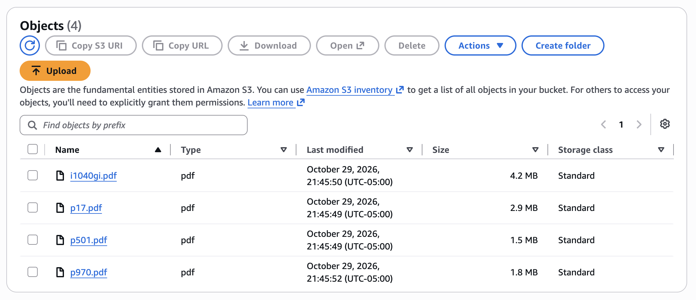
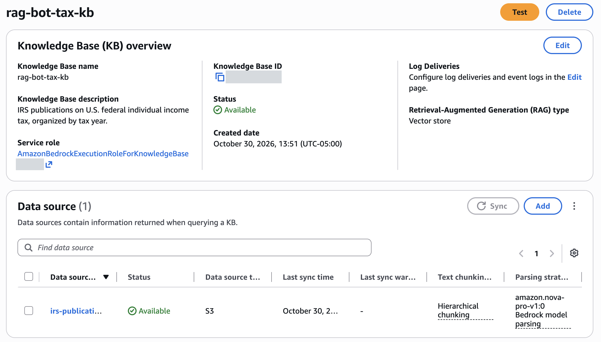
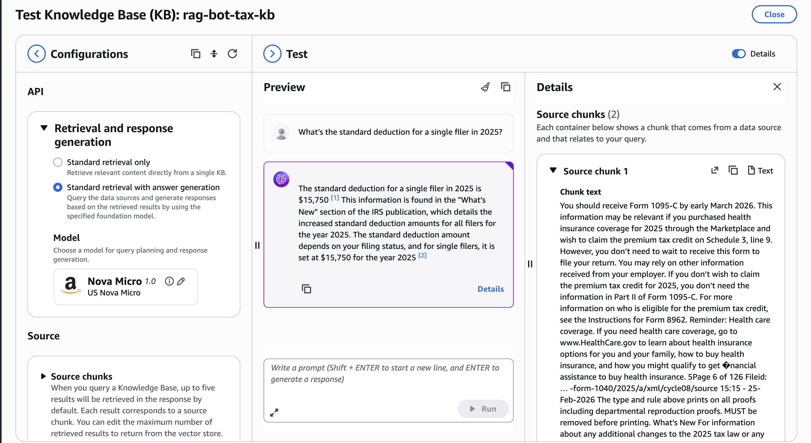
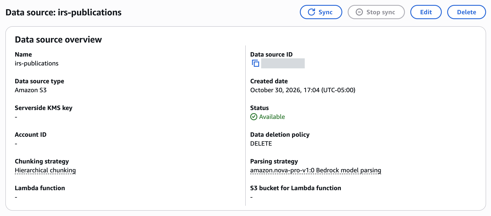
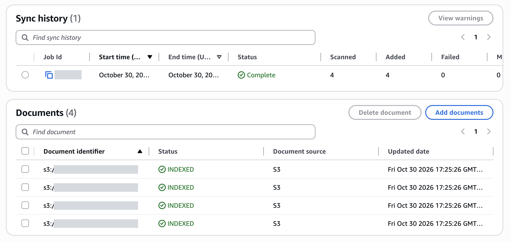
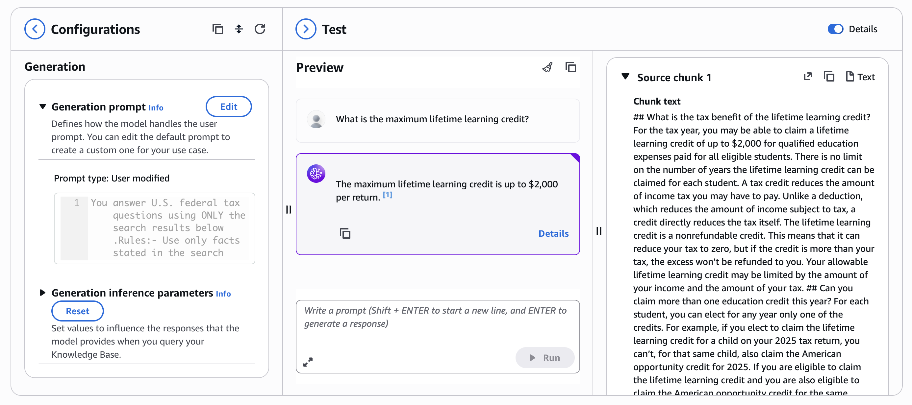
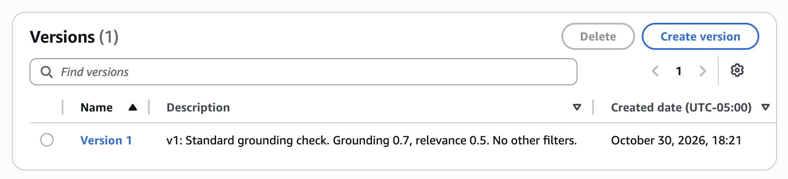
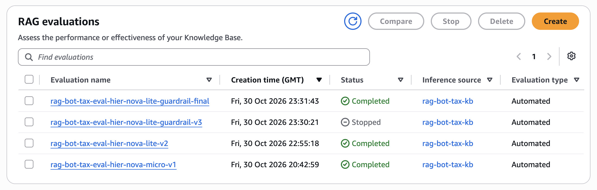
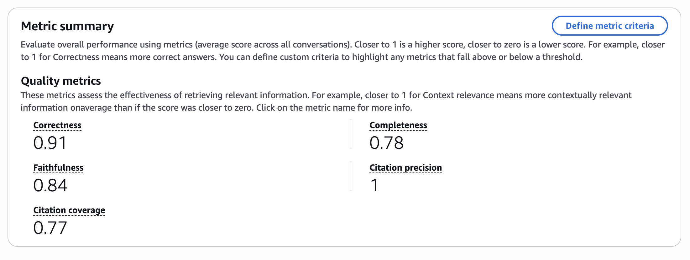

# IRS Tax Guide Bot

A RAG chatbot on Amazon Bedrock that explains U.S. federal tax rules for tax year 2025 using four official IRS publications, with sources for its answers and a guardrail against unsupported ones.

I don't have a deep understanding of my own taxes, and the rules change every year, so I built something I'd actually use. I measured it with evaluations at each stage, because a confident wrong tax answer can cost someone money.

> **Study aid only, not tax advice.** Check answers against the IRS source.

| Without RAG: Nova Micro alone | With this bot |
|---|---|
|  |  |

## How it works



| Part | Choice | Why | Tradeoff |
|---|---|---|---|
| Documents | IRS Pubs 17, 501, 970 and Form 1040 instructions (380 pages) | Official, free, updated yearly | Federal only |
| Parser | Foundation model: Nova Pro for Pub 501, Nova Lite for the rest | Reads tables as tables; Nova Lite kept the re-sync cheap | One-time cost per page |
| Syncing | Large PDFs split into 8-page parts, synced one at a time | Whole-PDF syncs went over my embedding limit and silently lost pages | 45 small files instead of 3 large ones |
| Chunking | Hierarchical (1,500 / 300 tokens, 60 overlap) | Keeps rules near their exceptions | The model reads more text per question |
| Embeddings | Titan Text V2, 1,024 dimensions | Inexpensive and standard | None significant at this size |
| Vector store | S3 Vectors | Far cheaper than OpenSearch Serverless | Semantic search only, no keyword matching |
| Answer model | Nova Lite | Close to Nova Pro on correctness, a third of the cost, and the only model tested that never used outside knowledge | Less complete answers than Nova Pro |
| Safety | Guardrails grounding check (grounding 0.7, relevance 0.5) | Blocks answers the passages don't support | Sometimes blocks answers that might be fine |

## Build process

Screenshots from the AWS console, in build order. Internal IDs and resource names are covered.

**1. Uploaded the IRS publications to a private S3 bucket.**



**2. Created the knowledge base,** using S3 Vectors and Titan embeddings.



**3. First test.** The answer was right, but the first citation pointed to an unrelated passage about health insurance forms. It also included printer's notes from the PDF, and this led me to look closely at parsing and citations.



**4. Rebuilt the data source** with the Nova Pro parser and hierarchical chunking, after evaluation showed search was missing tables.



**5. Synced the documents.** The console reported all four added, with none failed. I later found that most pages were missing (step 10).



**6. Tested the rebuilt knowledge base** with the strict prompt. The lifetime learning table can now be found, and the source chunk contains the $2,000 limit.



**7. Added the guardrail** and saved a numbered version, so test results stay repeatable.



**8. Evaluated each stage.** The stopped run used the fuller prompt I rejected, so it was ended early.



**9. Scores with the guardrail,** which match Run 3 in the results table below.



**10. Found and fixed silent data loss.** While tracing three wrong answers, I found the knowledge base held only 235 chunks, and three of the four documents were missing most of their pages. The sync log had an internal error even though the console showed it as Complete. I split the large PDFs into 8-page parts, synced them one at a time, and checked every page with `check_coverage.py`. The knowledge base now holds about 1,900 chunks. Run 4 below is the result.

## Results

I evaluated each stage on 27 test questions with Bedrock's knowledge base evaluations: simple lookups, rules with conditions, exact form names, and questions the bot should refuse.

| Metric (0 to 1) | Run 1: Baseline | Run 2: Fixes | Run 3: Guardrail | Run 4: Full documents |
|---|---|---|---|---|
| Correctness | Unreliable\* | 0.94 | 0.91 | 0.94 |
| Faithfulness | 0.80 | 0.91 | 0.84 | 0.89 |
| Completeness | 0.85 | 0.84 | 0.78 | 0.81 |
| Citation precision | 0.86 | 0.94 | 1.00\*\* | 0.96\*\* |
| Citation coverage | 0.85 | 0.85 | 0.77\*\* | 0.93\*\* |
| Answerable questions answered | — | — | 23 of 25 | 24 of 25 |

- **Run 1:** default parser, Nova Micro, default prompt, graded by Nova 2 Lite.
- **Run 2:** Nova Pro parser, Nova Lite, strict prompt, graded by Nova Pro.
- **Run 3:** Run 2 plus the guardrail, graded by Nova Pro.
- **Run 4:** Run 3 with every page of every document synced. Nothing else changed.

\* The grader scored only 10 of 27 questions on correctness, so I don't report that number. Because the grader changed after Run 1, Runs 2 to 4 are the fair comparison.

\*\* Citation metrics only score answers that have citations: 23 in Run 3 and 25 in Run 4. Run 4's precision dipped because the bot correctly refused the Texas question but attached a citation anyway.

**Runs 2 and 3 were measured on incomplete data, and Run 1 probably was too.** Three of the four documents were missing most of their pages, so those scores reflect only part of the IRS text. Fixing that fixed the student loan limit and the lifetime learning question with no prompt or guardrail changes.

**Why guardrail runs can score lower:** refusing is sometimes the goal, but the scoring treats it harshly. Blocked questions score 0, and faithfulness scores 0 for correct refusals like the Texas and 2026 questions. On the 24 questions it answered, Run 4 scored **0.98** correctness and **1.00** faithfulness. I chose the guardrail because a blocked answer is safer than the wrong answer it replaced, even though it lowers the averages.

### Choosing the answer model

Same 27 questions, full documents, strict prompt and guardrail, all graded by Nova Pro. Only the model writing the answers changed.

| | Nova Micro | Nova Lite (used) | Nova Pro |
|---|---|---|---|
| Correctness | 0.91 | 0.94 | 0.96 |
| Faithfulness | 0.80 | 0.89 | 0.95 |
| Completeness | 0.84 | 0.81 | 0.93 |
| Citation precision | 0.91 | 0.96 | 0.94 |
| Citation coverage | 0.90 | 0.93 | 0.98 |
| Blocked by the guardrail | 3 | 1 | 0 |
| Used outside knowledge | Yes (Texas) | No | Yes (Texas) |
| Cost per question, with guardrail | ~$0.002 | ~$0.002 | ~$0.006 |

Nova Pro scored highest, mainly on completeness. But asked about Texas, it said Texas has no income tax, a fact from its own training, not my documents, and the guardrail let it through. The fact is true, but a bot that adds outside facts can't be trusted to stick to its sources. Nova Micro was blocked on three questions, including a simple standard deduction lookup. I kept Nova Lite: nearly as correct as Pro, and the only model that stayed within its documents on every question.

The guardrail check costs about $0.002 per question, more than Nova Lite itself, so Micro and Lite cost about the same. These are single runs of 27 questions, and answers vary slightly between runs, so differences of a few hundredths are within noise.


## What I tried and what happened

**A sync marked Complete had lost most of my documents.** Three questions kept failing, and the student loan passage never appeared in search, even when I searched with its exact wording. Listing every chunk in the vector index showed Pub 970, Pub 17 and the Form 1040 instructions had only 29 chunks each, and Pub 970 stopped at page 45 of 81. The sync had logged an internal error, but the console still showed it as Complete with 0 failed documents. Bedrock's CloudWatch metrics showed the cause: my project's embedding limit is 60 requests per minute, against an AWS default of 6,000. During that sync, 4,310 embedding requests were refused and only about 400 went through. A re-sync with Nova Lite failed the same way: the parser read every page, but most were lost at the embedding step. The limit can't be raised from the Service Quotas page, so I split the large PDFs into 8-page parts and synced them one at a time. All 45 parts were stored completely, and all three failing questions were answered correctly.

**The baseline scores hid serious errors.** Reading individual answers mattered more than the averages. Nova Micro said the married filing jointly deduction was $25,900 when the correct figure, $31,500, was in its passages, and it invented Texas income tax rates. Texas has no state income tax.

**A strict prompt exposed a search problem.** Once the bot could only use its documents, it refused questions it had seemed to answer. Those earlier answers had likely come from the model's memory, not my documents.

**The default parser may not have been the whole problem.** The lifetime learning credit table never appeared in search results, even with 20 results requested. After re-parsing with a foundation model, it appeared in the top 5. I later found that syncs were losing pages, so the first sync may simply have been missing that table. The foundation model parser still turns tables into clean, searchable text.

**A guardrail caught what the prompt missed.** With the strict prompt alone, the bot wrongly said you can claim the lifetime learning credit while being claimed as a dependent. The guardrail blocked that answer.


**A better-looking prompt made things worse.** A friendlier prompt that asked for fuller answers let that same harmful answer through the guardrail, so I rejected it and kept the strict one.

**Query reformulation didn't help.** It didn't fix the failed questions and adds a step to every request, so I left it out. Requesting 10 passages instead of 5 was also worse: the bot used the overtime deduction's $12,500 limit as the student loan limit. The real limit was on a page the sync had lost, so no search setting could have found it.

**Fixing an IAM failure.** Evaluation jobs failed with an access denied error. The role's trust policy allowed `model-evaluation-job`, while this job type uses `evaluation-job`, and its permissions didn't cover the evaluation bucket or knowledge base. I corrected the trust policy and scoped access to one bucket, one knowledge base and one guardrail.

## Known limitations

- **Occasional overblocking:** answers vary slightly between runs, even at temperature 0. The self-employment question passed every direct test but was blocked once in Run 4.
- **Guardrail gaps:** it let Nova Pro's outside fact about Texas through, so it doesn't catch every answer that goes beyond the documents.
- **Embedding limit:** my project allows 60 embedding requests per minute, so new documents need to be split and synced in small parts.
- **Pub 501's last pages** (IRS contact information and the index) aren't stored. They hold no tax rules, so I didn't pay to re-parse them.
- **Test set:** the 27 questions were also used for tuning, so scores on new questions would likely be lower.
- **Terse answers:** the strict prompt leaves out some conditions, which keeps completeness at 0.81.
- **Scope:** federal rules for tax year 2025 only, from four publications.

## Run it yourself

You need an AWS account, a Bedrock knowledge base, and a guardrail.

```bash
python -m venv .venv
source .venv/bin/activate
pip install -r requirements.txt
cp .env.example .env
```

Add your IDs to `.env`, sign in with `aws login`, then start the app:

```bash
streamlit run app.py
```

To add documents, split large PDFs into 8-page parts, upload the parts to the data source's S3 folder, and sync:

```bash
python split_pdfs.py parts/ p17.pdf p970.pdf
```

After every sync, confirm each page was stored. The console can report Complete when it isn't:

```bash
python check_coverage.py
```

## Cost

Building and evaluating this project used **$4.62** of AWS services, as of October 31, 2026, all covered by free plan credits.

| Service | Cost |
|---|---|
| Amazon Bedrock (parsing, embeddings, models, evaluations, guardrail) | $4.59 |
| Other (Cost Explorer, S3) | $0.02 |

Nearly all of it was one-time build and testing work on October 30. Usage the next day was under one cent. I set a $10 monthly budget alert to catch any unexpected spending.

Fixing the knowledge base and running three more evaluations (Run 4 and the model comparison) on November 8 cost about **$3 more**, estimated from Bedrock's token counts at list prices. Most of it was Nova Pro, which graded all three runs and wrote the answers in one: about $2.30. Parsing the 349 pages with Nova Lite cost about $0.20 per pass.

## Future improvements

1. A larger test set, with questions held back from tuning.
2. Better search: hybrid keyword and semantic search, or chunks split by IRS section.
3. A hand-verified table of key limits, so exact numbers don't depend on search.
4. Tax-year labels, so 2026 documents can be added without mixing years.
5. More publications, including self-employment guides.
6. User feedback and logging in the app.
